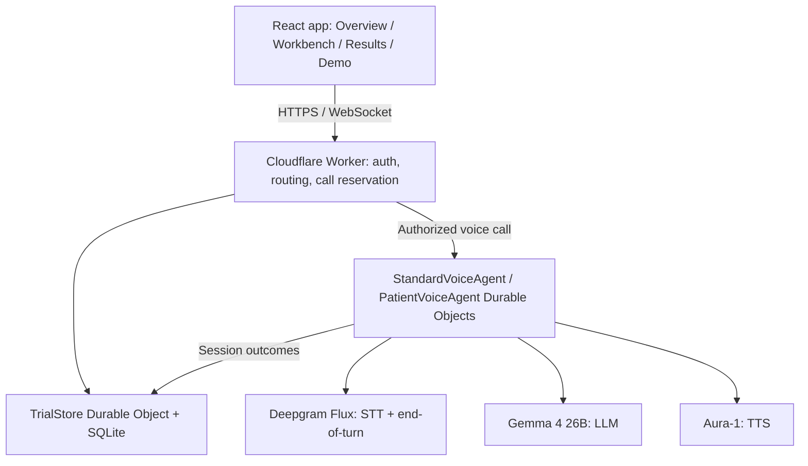

# PaceLab

### Voice agents should know when to listen.

**Compare. Diagnose. Improve.**

PaceLab is an open-source turn-taking evaluation prototype built on **Cloudflare's Agents SDK**. It explores how developers can test whether a voice agent responds at the right moment - not just whether it can hold a conversation.

**[Live app](https://pacelab.dakshkumar19860.workers.dev)** | **[Try the public demo](https://pacelab.dakshkumar19860.workers.dev/#/demo)** | **[Evaluation methodology](docs/METHODOLOGY.md)**

> **Project status:** The application, reference voice-agent configurations, guided testing workflow, storage, and reporting are implemented. The public demo uses clearly labeled **synthetic sample data**. The planned 24-trial live experiment is **not complete**, and the latest end-to-end production verification has been affected by Workers AI quota errors. Proposed integrations shown below are concepts, not shipped Cloudflare features.

## Why I built this

I started exploring voice-agent reliability after attending a Cloudflare x Coval event on what it takes to run voice AI in production. One question stood out: **How does a developer know an agent is ready for real conversations, not just a good demo?**

Imagine someone saying:

> "I need an appointment on Monday ... actually, Thursday afternoon."

A voice agent has to decide when that person is finished. Respond too soon and it may act on incomplete information. Wait too long and the interaction feels unnatural.

Pauses, hesitations, self-corrections, and interruptions make this difficult. And changing a turn-detection setting can improve one behavior while making another worse.

**The product question behind PaceLab:** When a developer changes an end-of-turn setting, how can they tell whether the conversation actually improved - and what trade-off did they introduce?

## The opportunity I'm exploring

Cloudflare already gives developers the building blocks for real-time voice agents, including the Agents SDK, Workers AI, turn outcomes, and timing diagnostics. Coval and other platforms already offer broader conversational evaluation, simulation, and regression testing.

I am **not** proposing that those capabilities do not exist. My narrower hypothesis is that developers using Cloudflare's voice SDK could benefit from a lightweight, reproducible way to test *turn-taking behavior during development*.

| Existing capability | Question PaceLab explores |
|---|---|
| Build and run voice agents with Cloudflare | How do I test the turn-taking experience before shipping? |
| Inspect SDK turn timings and outcomes | Was a quick response actually appropriate? |
| Use broader evaluation and observability products | Can a focused SDK-native benchmark make configuration changes easier to validate? |

The distinction is between **observing an agent** and **running a controlled experiment that informs a developer decision**. Whether an SDK example, open-source utility, or partner integration is the right solution is still an open question.

## What I built

PaceLab currently evaluates **one Cloudflare-based reference agent** in two configurations. The pipeline, prompt, model, and voice stay the same; the end-of-turn confidence threshold is the deliberate variable.

| Configuration | `eotThreshold` | What it tests |
|---|---:|---|
| Standard | `0.70` | A less conservative turn-ending threshold |
| Patient | `0.85` | A more conservative turn-ending threshold |

A higher threshold *may* reduce early turn commitments, but may also increase waiting time. The purpose of the experiment is to measure that trade-off, not assume a winner.

### Controlled experiment

The Workbench guides a tester through six scenarios: fluent speech, a short pause, a long pause, hesitations, self-correction, and multiple pauses.

The planned matrix is **6 scenarios x 2 configurations x 2 repetitions = 24 trials**, in a balanced order. A person reads each scripted request and follows visual pause markers. The same *words* are used across configurations, although manually repeated speech is not acoustically identical.

### Current capabilities

| Area | Implemented |
|---|---|
| Voice pipeline | Agents SDK `withVoice`, Deepgram Flux speech recognition / turn detection, Gemma 4 26B, Aura-1 speech synthesis |
| Guided testing | Six scenarios, pause guidance, recommended next trial, planned 24-trial matrix |
| Call handling | Microphone check, connection states, startup errors, optional auto-end after first reply |
| Evidence | Committed transcripts, agent replies, SDK timing measurements, event timeline, browser-side estimates |
| Human review | Premature reply, transcription correctness, response appropriateness, reply cut short; Yes / No / Unable to determine |
| Data integrity | Counted, Exploratory, Excluded, and Technical failure statuses |
| Reporting | Per-scenario and overall comparisons, example failures, metric glossary, decision summary, CSV export |
| Public demo | Interactive walkthrough with synthetic examples; no microphone, login, or AI inference required |
| Engineering | Durable Object storage, access control, usage limits, unit tests, smoke tests, CI |

**Current workflow:** `Configure -> Speak -> Observe -> Label -> Save -> Compare -> Decide`

### Measurement is not judgment

PaceLab keeps different forms of evidence separate:

| Label | Source | Example |
|---|---|---|
| `[SDK]` | Server-side SDK event or timing | Final transcript to first reply audio |
| `[M]` | Human evaluation | Did the agent interrupt an unfinished request? |
| `[~]` | Browser estimate | Perceived wait or held pause duration |

A transcript boundary is a technical event. It does **not** by itself prove that the agent interrupted someone. Trials with unknown outcomes are reported separately, and technical failures do not count as conversational failures.

The report uses an **Insufficient evidence** gate until each configuration has at least six judged trials. That gate is a safeguard against premature conclusions, **not** a claim of statistical significance.

## What I've learned so far

These are observations from development and exploratory testing, **not results from a completed controlled study**.

1. **Response speed alone isn't a quality metric.** A fast reply may be premature; a more patient setting may introduce noticeable waiting.
2. **Identical scripts are not identical audio.** Different pacing and intonation can change how Flux commits a turn. Recorded speech is the stronger comparison method.
3. **Existing timing metrics answer different questions.** Speech start to final transcript includes the user's speaking time and pauses; it is not pure system latency. Browser-estimated perceived wait is useful but approximate.
4. **Infrastructure errors must stay out of quality results.** Workers AI quota exhaustion caused speech-recognition startup failures during testing. PaceLab records those separately as technical failures. A later quota/dashboard mismatch remains unconfirmed as to its underlying cause.

One earlier exploratory multi-pause comparison suggested Standard might reply before the full request while Patient waited. **That single observation is not evidence that Patient is generally better.** The full 24-trial study has not been completed.

See [Findings](docs/FINDINGS.md), [Methodology](docs/METHODOLOGY.md), and [Developer Friction](docs/FRICTION.md).

## The next experiment: a reproducible turn-taking benchmark

The most useful next step is to **replay identical recorded human speech** through the Cloudflare voice pipeline, instead of asking a tester to repeat the same script aloud.

A proposed developer workflow:

1. **Select an agent** using the Cloudflare voice SDK.
2. **Choose or upload recorded speech** with known speech boundaries.
3. **Run the same audio against multiple end-of-turn settings** or agent versions.
4. **Compare the outcomes:** early turn commitments, wait after the last word, and possible regressions.
5. **Review the evidence** and choose the configuration that best fits the application.

This could make turn-taking tests reproducible and eventually suitable for automated developer workflows. The audio-replay harness, external-agent connection, and automatic regression testing are **not implemented in the current version**.

### Proposed Cloudflare developer experience

The following image illustrates one possible way the workflow *could* appear alongside Cloudflare's Agent tracing tools. It is a **product design concept**, not a screenshot of a working integration.


*Independent concept mockup only. Not an official, existing, or announced Cloudflare feature. The agent, 24-trial report, percentages (27% and 9%), charts, and UI actions shown here are illustrative, not measured PaceLab findings or implemented integrations.*

The product idea is simple: **make testing voice-agent turn-taking feel as accessible as testing application code.** It could become an Agents SDK example, a standalone open-source testing kit, or an integration with established evaluation tools. Developer feedback should determine which path is useful.

## Longer-term vision

Today, PaceLab tests its own reference agent with predefined scenarios. In the longer term, I want developers to be able to:

- **Connect their own agents**, starting with supported Cloudflare voice agents.
- **Test naturally**, without having to choose a pause or correction script every time; retain controlled cases for repeatable benchmarks.
- **Flag possible failures** such as interruptions, self-corrections, speech overlap, and latency issues, with supporting evidence and human review where appropriate.
- **Compare releases**, replay known cases, and catch regressions before deployment.

This is a product direction, not a description of shipped features. It is intended to complement, not replace, the broader capabilities of voice evaluation platforms.

## Architecture



The UI uses React and Vite; the application runs on Cloudflare Workers with Durable Objects for live agents and SQLite-backed experiment records. The two modes share their model pipeline, with only the end-of-turn threshold deliberately changed.

See [Architecture](docs/ARCHITECTURE.md).

## Run locally

**Requirements:** Node.js 22+, a Cloudflare account, and Workers AI access.

```sh
npm ci
npx wrangler login
cp .dev.vars.example .dev.vars
# Set your own local secrets in .dev.vars
npm run dev
```

The AI binding runs remotely, including during local development. Worker AI inference is subject to your account's quota and billing rules.

**Checks:**

```sh
npm run check
npm test
npm run build
```

Automated unit and smoke tests use mocks and local environments; they are **not proof that the full production microphone workflow currently passes**. See [Testing](docs/TESTING.md).

### Configuration

| Binding / secret | Purpose |
|---|---|
| `AI` | Workers AI inference |
| `StandardVoiceAgent`, `PatientVoiceAgent` | Voice sessions in Durable Objects |
| `TrialStore` | Trials, call accounting, authentication state |
| `ASSETS` | React frontend assets |
| `PACELAB_PASSPHRASE` | Private Workbench sign-in |
| `PACELAB_TOKEN_SECRET` | Session token signing key |

Both secrets are required for protected API and voice routes. Application safeguards in [`src/config.ts`](src/config.ts) include 30 established calls/day, 90 attempts/day, and a 90-second call limit. These are **app limits**, separate from Workers AI's available Neurons.

### Deployment

The repository uses Cloudflare Workers Builds. Pushes to `main` build and deploy the Worker; other branches create previews without production AI access or secrets. Configure secrets in the Cloudflare dashboard or through Wrangler before using live calls.

## Try the experiment

1. Sign in to the private Workbench.
2. Select the recommended configuration and scenario.
3. Start a call; wait until the agent is listening.
4. Speak the request and follow the guided pause markers.
5. Review the transcript, response, and measurements.
6. Record the four human judgments and the trial status.
7. Save and inspect the updated comparison in Results.

Startup failures, including provider quota errors, can be recorded as **Technical failure** rather than added to the experimental denominator.

The public [Interactive Demo](https://pacelab.dakshkumar19860.workers.dev/#/demo) requires no sign-in or microphone. **Its example results are synthetic.**

## Limitations and roadmap

| Today | Next step |
|---|---|
| Human-read scripts vary between repetitions | Recorded human audio replay with known timestamps |
| One reference agent, two thresholds | More configurations and developer-owned Cloudflare agents |
| Manual review of conversational outcomes | Evidence-backed automatic *flags*, with human verification |
| Browser-estimated perceived wait | Better isolation of speech-end-to-commit delay |
| Small, incomplete exploratory study | Complete the study and publish results with appropriate caveats |
| Quota-sensitive real voice inference | More predictable test budgeting and clearer failure diagnostics |

The goal is to validate the smallest useful developer workflow before expanding to broader evaluation or third-party integrations.

## Data, privacy, and security

PaceLab processes microphone audio during live speech recognition **but does not store audio recordings**. It stores transcripts, agent responses, timing measurements, trial metadata, manual labels, and technical failure details. The controlled scripts use fictional requests; genuine completed live trials, if collected, are real observations. The public demo's data is synthetic and separate from live records.

The live Workbench and Results require passphrase authentication. Protected routes use session cookies, origin checks, login lockout, and call limits. Do not commit `.dev.vars` or any secret. Optional audio recording or replay in a future version would require consent, retention, and deletion controls.

## Documentation

- [Architecture](docs/ARCHITECTURE.md) - infrastructure, session flow, and storage
- [Methodology](docs/METHODOLOGY.md) - test protocol, labels, threats to validity
- [Testing](docs/TESTING.md) - automated and manual verification
- [Findings](docs/FINDINGS.md) - observations and evidence status
- [Developer Friction](docs/FRICTION.md) - SDK and infrastructure issues encountered
- [Decision Memo](docs/DECISION_MEMO.md) - framework for interpreting the comparison
- [Demo Guide](docs/DEMO.md) - short project walkthrough

## Contributing and license

Issues, technical feedback, and pull requests are welcome. Preserve the distinction between measured evidence, estimated values, and human judgments, and run `npm run check && npm test && npm run build` before submitting changes.

MIT license - see [LICENSE](LICENSE). Copyright Daksh Kumar. Original Cloudflare Inc. license notices remain for the parts derived from `cloudflare/agents-starter`.

---

**The question behind PaceLab:** Cloudflare makes it easier to build and deploy voice agents. Could testing their conversational reliability become just as natural a part of the developer workflow?

*PaceLab is an independent open-source project, not an official Cloudflare product or integration.*
