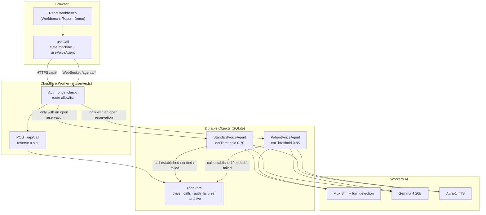
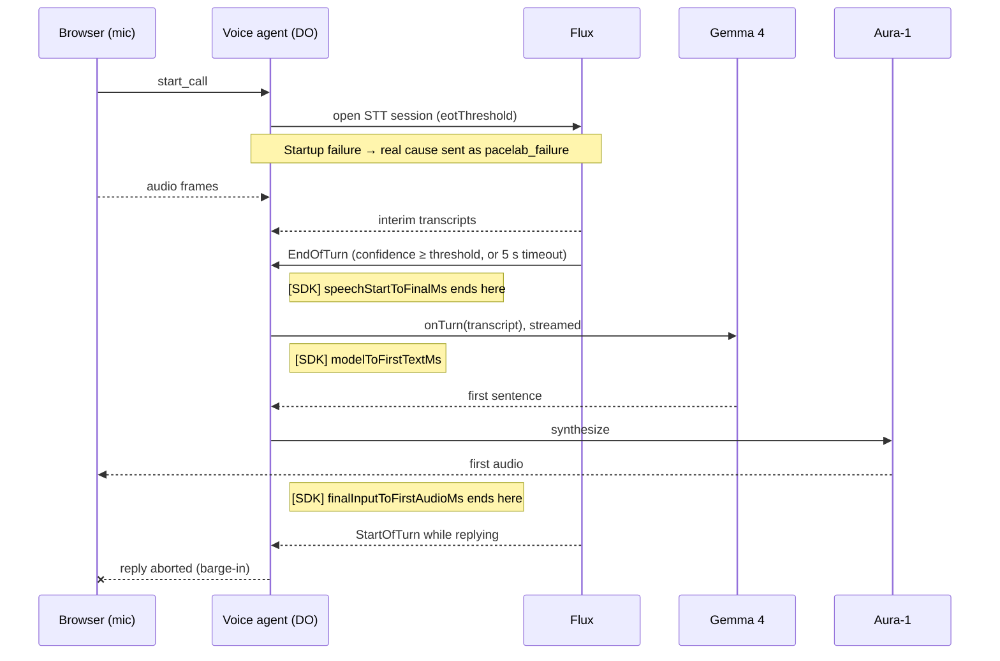
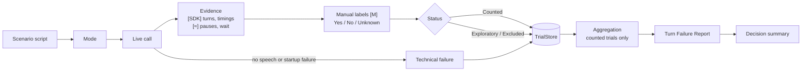

# PaceLab

**Compare. Diagnose. Improve.**

PaceLab is a test bench that measures whether a real-time voice agent waits for people to finish speaking, and compares two end-of-turn settings on the same scripted requests.

Live: <https://pacelab.dakshkumar19860.workers.dev> (the [demo](https://pacelab.dakshkumar19860.workers.dev/?demo) needs no sign-in and no microphone).

## The problem

A voice demo answers "can this agent talk?" Real callers pause mid-sentence, say "um", correct themselves and trail off. Each of those silences is a chance for the agent to decide the caller is done and start answering. The caller gets cut off, the agent answers half a question, and nothing in a happy-path demo shows it.

Turn detection is a tunable trade-off. Cloudflare's Agents SDK voice pipeline uses Deepgram Flux, whose `eotThreshold` sets how confident Flux must be before it ends the caller's turn. A lower threshold answers sooner and interrupts more; a higher one waits longer. That trade-off is usually tuned by feel.

## What PaceLab does

PaceLab turns the trade-off into a controlled, repeatable experiment:

- **Two configurations, one variable.** Standard (`eotThreshold` 0.70) and Patient (0.85) share the same prompt, model, voice and scripts.
- **Six scripted scenarios** with pauses, fillers and self-corrections, read aloud by a person with a silent pause timer.
- **A guided 24-trial matrix:** 6 scenarios × 2 modes × 2 repeats, in a balanced order, with the next trial always recommended.
- **Evidence kept separate from judgment.** What the SDK measured, what a person judged and what the browser estimated are stored and labelled separately.
- **A Turn Failure Report** compares the modes with correct denominators and says "Insufficient evidence" until there is enough data.

```
Configure → Speak → Observe → Label → Save → Compare → Decide
```

## Features

| Area | What exists |
|---|---|
| Live calls | Two voice modes on the Agents SDK (`withVoice`), Flux STT, Gemma 4 26B, Aura-1 TTS |
| Reliability | Microphone check before any call slot is used; a call state machine (`idle → checking_mic → connecting → listening ⇄ responding → stopping`, plus `failed`); startup timeout; the real cause of a speech-recognition startup failure shown to the user |
| Guided experiment | Scenario scripts with pause markers that fill while you hold the pause; the 24-trial matrix; recommended next trial; optional auto-end after the first reply to save Workers AI allocation |
| Evidence | Committed SDK turns, transcripts, agent reply, SDK turn timings, an event timeline, "Cut me off" presses, approximate held pauses and perceived wait |
| Labelling | Premature reply, transcription correct, reply appropriate, reply cut short: each Yes / No / Unable to determine. Trial status: Counted, Exploratory, Excluded (reason required), Technical failure |
| Report | Standard vs Patient per scenario and overall, premature-response chart, example failures, metric glossary, decision summary, CSV export |
| Demo mode | Synthetic, clearly labelled data. Calls nothing on the server and is never stored |
| Safety | Passphrase sign-in with HttpOnly session cookie and lockout; same-origin checks; 30 calls/day cap and 90-second call limit; delete-all needs a typed count and archives instead of destroying |
| Quality | 45 unit tests, local API and browser smoke tests, GitHub Actions CI (type check, tests, build) |

## Architecture



More: [docs/ARCHITECTURE.md](docs/ARCHITECTURE.md).

## Real-time voice pipeline



The browser estimates perceived wait (`[≈]`) from the last moment the mic heard a voice to the first reply audio. That span includes the end-of-turn wait, which no SDK metric covers.

## Evaluation pipeline



## Standard vs Patient

| | Standard | Patient |
|---|---|---|
| `eotThreshold` | 0.70 | 0.85 |
| `eotTimeoutMs` | 5000 | 5000 |
| Prompt, model, voice | same | same |
| Scripts, pause lengths | same | same |
| Expected behaviour | answers sooner, more likely to answer during a pause | waits longer, less likely to cut in |

## Methodology in brief

Six scenarios (fluent baseline, 2 s pause, 3 s pause, fillers, self-correction, two 2 s pauses), two runs each per mode, read by one person. A split request is recorded as an SDK fact; whether the agent replied too early is a human judgment. Rates use only trials judged Yes or No. Full protocol, label definitions and threats to validity: [docs/METHODOLOGY.md](docs/METHODOLOGY.md).

## Getting started

Requirements: Node 22 or newer, a Cloudflare account (Workers Free is enough).

```sh
npm ci
npx wrangler login        # the AI binding always runs remotely, even in dev
cp .dev.vars.example .dev.vars   # then set your own values
npm run dev
```

Checks:

```sh
npm run check   # TypeScript
npm test        # unit tests (node --test)
npm run build
```

Local API and browser smoke tests are in [docs/TESTING.md](docs/TESTING.md). They refuse to run against anything but localhost.

## Configuration

| Name | Kind | Purpose |
|---|---|---|
| `AI` | Workers AI binding | Flux, Gemma 4, Aura-1 |
| `StandardVoiceAgent`, `PatientVoiceAgent` | Durable Objects | One instance per call |
| `TrialStore` | Durable Object | Trials, call accounting, sign-in lockout |
| `ASSETS` | Static assets | The React app |
| `PACELAB_PASSPHRASE` | Secret | Sign-in passphrase |
| `PACELAB_TOKEN_SECRET` | Secret | HMAC key for session tokens, separate from the passphrase |

Without both secrets every `/api` and `/agents` route returns 503, so nothing can spend Workers AI. Limits live in [`src/config.ts`](src/config.ts): 30 established calls a day, 90 attempts a day, 90-second calls.

## Deployment

The repository is connected to Cloudflare Workers Builds. A push to `main` runs `npm run build` then `npx wrangler deploy`. Pushes to other branches run `npx wrangler preview`; the `previews` block in [`wrangler.jsonc`](wrangler.jsonc) gives previews no AI binding and no secrets, so a preview serves the page and the demo but cannot run calls or spend Workers AI.

Set the two secrets in the dashboard (Worker → Settings → Variables and Secrets) or with `npx wrangler secret put`.

## Running a test

1. Sign in. The Experiment panel shows progress, calls left today and the recommended next trial.
2. Check the mode and scenario (the recommendation is pre-selected).
3. Press **Start call**, wait for "Listening", then read the script. Hold each pause until its marker fills.
4. If the agent cuts in, press **Cut me off**. The call ends by itself after the first reply (you can turn that off).
5. Answer the four questions, choose Counted, and save. The matrix and report update.

If the call fails to start, PaceLab says why (for example, the Workers AI daily allocation is used up) and offers to record it as a technical failure, which never enters the experiment counts.

## Reading the results

- **[M]** manual judgment, **[SDK]** Agents SDK server timing, **[≈]** browser estimate.
- A rate like `3/11 (27%) · 1 unknown` means 3 of the 11 trials judged Yes or No; the unknown is listed, not counted.
- *Speech start → final transcript* includes your own speaking time and pauses. It is not latency.
- *Final transcript → first audio* is mostly the model's start-up time and does not depend on the threshold.
- The decision summary says *Insufficient evidence* until each mode has at least 6 judged trials, and never claims significance.

## Current findings

The 24-trial experiment has not been run yet. One exploratory multi-pause run (Standard replied early, Patient waited) and the diagnosis of startup failures are in [docs/FINDINGS.md](docs/FINDINGS.md). SDK friction is logged in [docs/FRICTION.md](docs/FRICTION.md). The PM decision memo is in [docs/DECISION_MEMO.md](docs/DECISION_MEMO.md) and a two-minute walkthrough in [docs/DEMO.md](docs/DEMO.md).

## Known limitations

- **Workers AI free allocation.** 10,000 neurons a day. Flux bills for every minute a call is open, so the allocation covers roughly 20 short calls, fewer than the app's 30-call cap. Plan the 24 trials over one or two UTC days and keep auto-end on.
- **One speaker, human timing.** Pauses are held by a person; the measured pauses are shown but not controlled. Recorded audio would remove this.
- **False barge-in.** Any Flux speech start aborts the reply, and Flux sometimes detects speech in near-silence ([F7, F8](docs/FRICTION.md)). Record such trials as excluded.
- **Perceived wait is approximate.** It comes from the browser's mic level.
- **Microphone tests are manual.** Automated tests use mocks and a fake microphone; real voice calls must be checked by a person in Chrome.

## Roadmap

1. Run and publish the 24-trial matrix, then fill in the decision memo.
2. Replay recorded audio so both modes hear identical input.
3. Separate backchannels ("mm-hm") and corrections from real interruptions.
4. More end-of-turn strategies, such as threshold plus timeout combinations.

## Contributing

Issues and pull requests are welcome. Keep the threshold the only difference between modes, keep manual judgments separate from measurements, and run `npm run check && npm test && npm run build` before opening a PR. Do not commit `.dev.vars` or any secret.

## License

MIT; see [LICENSE](LICENSE). The LICENSE file came from the Cloudflare starter template and still names "Cloudflare Inc." as copyright holder; the project owner should confirm the intended holder.

## Privacy

Only transcripts, labels and timings are stored. No audio is recorded. All test content is fictional.
