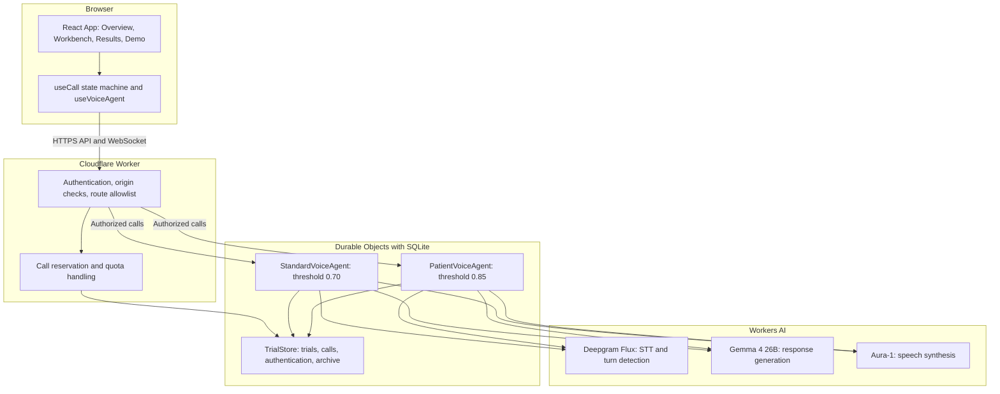
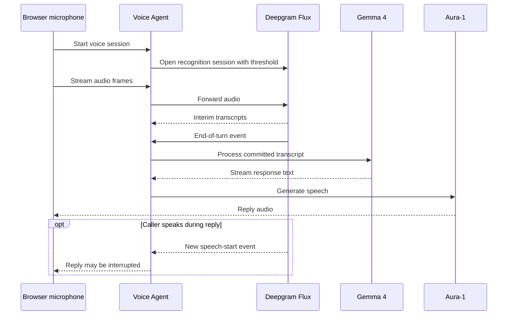

# PaceLab

### Voice agents should know when to listen.

An open-source turn-taking evaluation project built on Cloudflare's Agents SDK.

**Compare. Diagnose. Improve.**

[Live Website](https://pacelab.dakshkumar19860.workers.dev) · [Interactive Demo](https://pacelab.dakshkumar19860.workers.dev/#/demo)

Voice agents can generate impressive responses. But knowing *when* to respond is a different problem.

PaceLab investigates how real-time voice agents handle pauses, hesitations, corrections, and interruptions. It helps developers compare turn-taking configurations, inspect what happened during a conversation, and understand the trade-off between responding too early and making users wait.

The current version evaluates a reference voice agent built on Cloudflare. The longer-term direction is reproducible voice-agent testing that fits naturally into a developer's workflow.

---

## 1. Why I built PaceLab

I started exploring Cloudflare's voice-agent capabilities after attending a Cloudflare × Coval event about building voice AI that holds up in production.

One question stayed with me:

**How does a developer know their voice agent is ready for real human conversations, not just a successful demo?**

Consider a caller saying:

> "I'd like to schedule an appointment for Monday... actually, wait... Thursday afternoon."

The agent has to decide whether the caller has finished.

Respond too early, and it might act on the wrong information.

Wait too long, and the conversation feels slow and unnatural.

This is especially difficult when people pause mid-sentence, restart thoughts, hesitate, or correct themselves.

Voice-agent performance isn't only about speech recognition or the quality of an AI-generated response. The timing of the interaction affects the entire experience.

That led me to a more specific engineering question:

**If I change how an agent detects the end of a user's turn, how can I measure whether the conversation actually improves?**

PaceLab is my attempt to investigate that question through controlled testing.

## 2. Understanding the developer experience gap

Cloudflare already provides much of the technology developers need to build and operate voice agents.

Its Agents SDK supports real-time voice interactions. Workers AI provides inference for speech recognition, language generation, and speech synthesis. The voice pipeline also exposes timing measurements and turn outcomes that help developers inspect behavior.

These are important capabilities.

But measuring what happened and evaluating whether the behavior was good are different tasks.

For example, a developer might adjust an end-of-turn threshold and observe that the agent responds more slowly. That alone doesn't answer whether the change reduced premature interruptions enough to justify the additional wait.

Developers need a way to connect technical measurements with conversational outcomes.

PaceLab explores that workflow:

- Run comparable conversations against different configurations.
- Capture turn-taking events and timing measurements.
- Evaluate whether the agent understood the complete request.
- Distinguish premature responses from ordinary transcript boundaries.
- Compare results rather than relying on intuition.
- Identify changes worth investigating further.

This is not a claim that Cloudflare lacks observability or that conversational evaluation is an entirely unsolved category.

Companies such as Coval already provide broader voice-agent evaluation and regression-testing solutions.

The opportunity I'm exploring is narrower: **could reproducible, turn-taking-specific testing become a more accessible part of the Cloudflare voice-agent developer experience?**

## 3. What PaceLab does today

PaceLab is a deployed test bench built around a Cloudflare-based reference voice agent.

It compares two configurations of the same voice pipeline.

| Configuration | `eotThreshold` | Purpose |
|---|---:|---|
| Standard | 0.70 | Tests a less conservative turn-ending threshold |
| Patient | 0.85 | Tests a more conservative turn-ending threshold |

Both configurations use the same prompt, language model, speech synthesis model, and scripted inputs.

The only intentionally changed variable is the end-of-turn confidence threshold.

The experiment tests whether different thresholds affect how the agent behaves when a speaker pauses, hesitates, or corrects a request.

A higher threshold may reduce premature turn commitments, but it can also increase the time before the agent responds. The actual outcome depends on the speech input and runtime conditions.

PaceLab is designed to measure that trade-off, not assume which configuration is better.

### Controlled scenarios

The current test suite includes six speaking patterns:

| Scenario | What it investigates |
|---|---|
| Fluent baseline | Whether ordinary speech is recognized and answered correctly |
| Short pause | Whether a brief pause causes an early response |
| Long pause | How the agent handles a longer thinking pause |
| Hesitations | Whether fillers and restarts affect turn detection |
| Self-correction | Whether the agent captures a corrected detail |
| Multiple pauses | Whether repeated pauses cause premature turn-taking |

Each scenario is run twice in both configurations.

That produces a planned experiment of 24 trials:

6 scenarios × 2 configurations × 2 repetitions.

PaceLab recommends the next trial automatically and balances the test order so the same configuration does not always run first.

The scenarios are controlled test cases, not information the agent needs in order to understand the caller. The voice agent itself processes the spoken conversation through its normal pipeline.

## 4. The evaluation workflow

```text
Configure → Speak → Observe → Label → Save → Compare → Decide
```

A developer selects a configuration and runs a scripted request.

PaceLab captures the committed conversation turns, transcript, response, available SDK timing measurements, and browser-side estimates.

After the call, the developer evaluates what occurred.

The results are saved and incorporated into a comparison report.

### Separating measurement from interpretation

One design decision is central to PaceLab: technical events and human judgments should not be treated as the same thing.

| Evidence | Source | Example |
|---|---|---|
| SDK measurement | Agents SDK | Time from final transcript to first reply audio |
| Human judgment | Tester | Whether the reply interrupted an unfinished request |
| Browser estimate | Client microphone | Approximate pause duration or perceived wait |

PaceLab labels these sources as:

- `[SDK]` — SDK measurements collected on the server clock.
- `[M]` — Manual evaluation performed by the tester.
- `[≈]` — Approximate measurements from the browser.

For example, a speech-recognition system committing a turn is an observable event.

But a turn commitment does not automatically prove the agent interrupted inappropriately. A person may have genuinely finished speaking.

The evaluation must account for that distinction.

### What gets evaluated?

After a call, the tester can review:

- Whether the agent replied prematurely.
- Whether the request was transcribed correctly.
- Whether the response addressed the intended request.
- Whether the response was cut short.

Each judgment supports Yes, No, or Unable to determine.

Trials can be saved as Counted, Exploratory, Excluded, or Technical failure.

Only appropriate counted trials enter the experiment's comparative metrics.

This prevents infrastructure errors or uncertain observations from distorting the results.

## 5. Features

| Area | Current implementation |
|---|---|
| Voice agent | Cloudflare Agents SDK `withVoice`, Deepgram Flux, Gemma 4 26B, Aura-1 |
| Turn-taking comparison | Standard and Patient configurations with different end-of-turn thresholds |
| Guided testing | Six scenarios, silent pause guidance, 24-trial matrix, recommended next trial |
| Live session | Microphone permission checks, call state handling, live transcripts, automatic end after first reply |
| Evidence collection | Committed turns, SDK timing measurements, agent responses, event timelines, approximate pauses |
| Human evaluation | Four conversational-quality labels with Unknown support |
| Reporting | Standard versus Patient comparisons, scenario-level breakdown, premature-response chart, decision summary |
| Experiment integrity | Separate counted, exploratory, excluded, and technical-failure records |
| Export | Download trial evidence as CSV |
| Public demo | Interactive synthetic example requiring no login, microphone, or AI inference |
| Access control | Passphrase authentication, secure session cookies, same-origin checks, sign-in lockout |
| Usage protection | Daily call limits, maximum call duration, failure-aware accounting |
| Automated quality checks | Type checking, unit tests, API smoke tests, browser tests, GitHub Actions CI |

### Public demo

The [interactive demo](https://pacelab.dakshkumar19860.workers.dev/#/demo) walks through a simulated conversation and a complete sample evaluation report.

The demonstration uses explicitly labeled synthetic data. Its transcripts, results, and comparison percentages are illustrative, not findings from the real 24-trial experiment.

The public demo does not call an AI model or consume Workers AI allocation.

Live testing and real experiment records are kept separately behind authentication.

---

## 6. Architecture

PaceLab runs on Cloudflare's developer platform.



The application uses Durable Objects for voice-agent sessions and SQLite-backed experiment storage.

Authentication and call reservations prevent unauthorized access to live AI inference.

More details: [Architecture](docs/ARCHITECTURE.md).

### Voice pipeline



The reference agent uses the same model pipeline for both configurations.

This makes it possible to investigate how end-of-turn settings affect behavior without intentionally changing the language model or voice.

## 7. What the measurements tell us

A major lesson from building PaceLab is that not every timing measurement answers the same question.

### Speech start to final transcript

This measures elapsed time from the beginning of detected speech to a committed transcript.

It includes the user's speaking time and pauses.

It should not be interpreted as pure system latency.

### Final transcript to first audio

This measures how long the system takes to begin speaking after the transcript is committed.

It includes downstream processing such as language generation and speech synthesis.

### Perceived wait

The browser estimates the gap between the last detected spoken audio and the first reply audio.

This is closer to what the user experiences, but it is approximate because microphone-level detection and browser timing have limitations.

### The metric I want to investigate next

A particularly useful measurement would isolate the interval between the speaker's actual final word and the agent's end-of-turn commitment.

That would help developers examine the cost of waiting for greater certainty, independently from the time spent generating the response.

One potential SDK-level improvement is exposing or deriving that measurement more reliably.

## 8. What I've learned so far

PaceLab has generated useful engineering observations, but the complete controlled experiment has not yet been run.

### Finding 1: Turn-taking is a measurable product trade-off

The question isn't simply whether the agent responds quickly.

A useful evaluation needs to examine both premature turn-taking and the delay introduced by more conservative detection.

### Finding 2: The same script is not necessarily the same input

When a person reads a sentence twice, they may change their intonation, speaking speed, or pause duration.

That weakens direct comparisons between configurations.

A stronger next experiment would use recorded human speech replayed identically into each configuration.

### Finding 3: Diagnostics and evaluations serve different purposes

Voice diagnostics tell developers about system behavior.

A testing workflow connects those observations to a specific question, comparable inputs, and interpretable outcomes.

PaceLab explores that layer between instrumentation and developer decisions.

### Finding 4: Infrastructure failures need to be separated from conversational failures

During development, Workers AI quota exhaustion prevented speech recognition from starting.

PaceLab initially surfaced this as a general speech-recognition startup problem. The error-handling workflow was improved to identify the provider's quota response and record the attempt as a technical failure.

Later testing also encountered quota errors after the dashboard displayed a reset daily allowance. The cause of that discrepancy has not been independently confirmed.

These events are infrastructure failures, not evidence that either turn-taking configuration is worse.

### Current evidence status

The planned 24-trial experiment has not been completed.

An earlier exploratory comparison suggested that Standard could reply during a multi-pause request while Patient waited for more of the request. That observation is not sufficient to establish a general performance advantage.

The public demonstration's completed trial matrix is synthetic and must not be interpreted as experimental evidence.

See [Findings](docs/FINDINGS.md) and [Developer Friction](docs/FRICTION.md).

---

## 9. The bigger opportunity

PaceLab started as a focused experiment using a reference voice agent.

The longer-term idea is a developer tool that helps teams evaluate conversational reliability before deploying changes.

The intended workflow is:

```text
Connect an agent
       ↓
Run natural or controlled tests
       ↓
Analyze conversation evidence
       ↓
Identify possible failures
       ↓
Compare configurations or versions
       ↓
Make an informed engineering decision
```

### Connect an agent

Today, PaceLab tests its own Cloudflare-based reference agent.

A future version could support developers' existing Cloudflare voice agents and eventually selected third-party voice platforms.

### Test naturally

The current Workbench uses predefined scenarios because controlled experiments need comparable inputs.

In a future natural-testing workflow, users would not need to choose a hesitation, pause, or correction scenario before speaking.

PaceLab would analyze observed conversational behavior afterward, while retaining optional scripted benchmarks for reproducibility.

### Analyze conversational behavior

Potential future evaluations include:

- Premature turn commitments.
- Speech overlap and interruptions.
- Hesitations and self-corrections.
- Response latency.
- Missed or misunderstood request details.

Automated detection should identify possible issues and provide supporting evidence rather than claim that every conversational failure can be judged with certainty.

### Detect regressions

A longer-term goal is repeatable testing after an agent's configuration, prompt, model, or voice pipeline changes.

Instead of asking whether a new configuration *feels* better, a developer could compare results against a known baseline.

## 10. The next technical opportunity: Reproducible turn-taking tests

The most focused next step is an audio-replay test harness for Cloudflare's voice SDK.

A developer would provide recorded human speech and run it against multiple end-of-turn configurations.

PaceLab could then compare:

- Whether a turn was committed before the known end of the recorded request.
- How long the system waited after the final word.
- How often configurations produced premature turn commitments.
- Whether a code or configuration change introduced a regression.

Using identical recorded inputs would remove much of the variation introduced by manually repeating scripts.

This would make PaceLab more useful as a developer testing utility, rather than only an interactive demonstration.

A potential implementation could live as an open-source testing kit, an SDK example, or a developer workflow integrated with existing evaluation products.

Those integration paths are hypotheses to validate with developers and platform teams.

### Proposed Cloudflare developer experience

What could this look like for a developer already using Cloudflare? Imagine opening a voice-testing tab alongside Agent tracing, selecting an existing voice agent, replaying the same recorded speech across turn-detection configurations, and comparing premature commitments with response delays.

The goal would be to make **testing conversational reliability a natural part of the developer workflow**, without needing to build a separate evaluation harness for every project.

*Product concept — independent illustration of how PaceLab could fit into Cloudflare's developer dashboard. Not an existing or announced Cloudflare feature or official partnership. The agent, 24-trial results, 27% / 9% values, charts, and buttons are illustrative; these are not PaceLab's measured findings or currently implemented integrations.*

This interface is one possible direction, not a finalized feature specification. The most useful next step would be to validate the need for a small, reproducible turn-taking benchmark with Cloudflare developers and the team building the voice SDK.


## 11. Where PaceLab fits in the ecosystem

Cloudflare already provides the infrastructure and observability needed to build and operate real-time agents.

Coval and other evaluation platforms address broader conversational testing, simulation, and monitoring.

PaceLab does not aim to reproduce all of those capabilities.

Its current focus is narrower:

**A lightweight, reproducible way to investigate the behavior of Cloudflare's voice-agent pipeline and turn technical measurements into actionable developer experiments.**

Whether this belongs in the Agents SDK examples, a standalone open-source tool, or a broader evaluation integration is an open product question.

---

## 12. Getting started

Requirements:

- Node.js 22 or newer.
- A Cloudflare account.
- Workers AI access.

Workers AI has usage limits, including a daily free Neuron allowance. Live calls can consume that allowance.

Clone the repository and install dependencies:

```sh
npm ci
npx wrangler login
cp .dev.vars.example .dev.vars
npm run dev
```

Configure the development secrets in `.dev.vars`.

The Workers AI binding uses remote inference even during development.

### Run checks

```sh
npm run check
npm test
npm run build
```

The repository also includes local API and browser smoke tests.

Those tests use local or mocked environments and do not replace a real microphone-based production test.

See [Testing](docs/TESTING.md).

## 13. Configuration

| Name | Type | Purpose |
|---|---|---|
| `AI` | Workers AI binding | Model inference |
| `StandardVoiceAgent` | Durable Object | Reference agent with threshold 0.70 |
| `PatientVoiceAgent` | Durable Object | Reference agent with threshold 0.85 |
| `TrialStore` | Durable Object | Experiment records, call accounting, authentication data |
| `ASSETS` | Static assets | React frontend |
| `PACELAB_PASSPHRASE` | Secret | Protected Workbench and Results access |
| `PACELAB_TOKEN_SECRET` | Secret | Session token signing |

The two secrets must be configured for protected API and voice routes to function.

PaceLab's application-level limits are defined in [`src/config.ts`](src/config.ts):

- 30 established calls per day.
- 90 call attempts per day.
- 90-second maximum call duration.

These are application safeguards, not guarantees that the Workers AI account's daily Neuron allowance will be sufficient.

## 14. Deployment

PaceLab is deployed through Cloudflare Workers Builds.

Pushes to `main` run the application build and deploy the Worker.

Non-main branches use Cloudflare preview deployments.

Preview environments deliberately exclude Workers AI access and production secrets. They can display the interface and synthetic demo but cannot run real voice calls.

Production secrets must be configured in the Cloudflare dashboard or using Wrangler.

The deployed application is available at:

https://pacelab.dakshkumar19860.workers.dev

The public Overview and Demo pages do not require authentication.

The Workbench and real experiment Results are protected because live calls consume the deployment owner's AI allocation.

## 15. Running an evaluation

1. Sign in to the Workbench.
2. Follow the recommended configuration and scenario.
3. Start a voice call and wait for the Listening state.
4. Read the request naturally, following the pause markers when applicable.
5. Review the committed transcript and the agent's reply.
6. Answer the evaluation questions.
7. Save the trial using the appropriate status.
8. Review the updated experiment in Results.

The call can automatically end after the first agent reply to reduce Workers AI consumption.

If the provider fails before the conversation starts, the attempt can be saved as a technical failure rather than counted as a conversational test.

## 16. Reading the results

PaceLab's reporting system distinguishes:

- Measured events.
- Human judgments.
- Browser estimates.
- Successful trials.
- Technical failures and excluded observations.

Unknown judgments are displayed separately from Yes/No rates.

A decision summary remains marked as Insufficient evidence until there are at least six judged trials per configuration.

That threshold is a reporting safeguard, not proof of statistical significance.

With a small sample, one speaker, and manually repeated requests, comparisons should be interpreted as exploratory rather than conclusive.

For the full experimental protocol, see [Methodology](docs/METHODOLOGY.md).

## 17. Known limitations

### Experiment size

The initial design uses 24 planned trials. This is useful for exploration but not sufficient to generalize across speakers, acoustic environments, and applications.

### Manual speech variability

Repeated spoken requests are not acoustically identical. Exact audio replay is a planned improvement.

### Human evaluation

Some conversational outcomes require context and judgment. A transcript split alone cannot establish whether an interruption was inappropriate.

### Browser timing estimates

Pause duration and perceived wait are approximate measurements.

### SDK behavior

The current voice pipeline may interrupt its own reply when Flux detects new speech. False speech-start events can complicate evaluation.

### Workers AI quota

The daily free allocation can block live calls. The application's call cap is independent of Workers AI's Neuron allowance.

### Live test verification

Automated checks cover application behavior using mocks and local tests. The complete live microphone workflow requires separate production verification.

### External-agent support

PaceLab does not currently connect directly to arbitrary customer voice agents.

## 18. Roadmap

### Near term

1. Complete and document the controlled turn-taking experiment.
2. Improve reproducibility with identical recorded-audio inputs.
3. Measure premature commitments against end-of-turn waiting time.
4. Investigate SDK-level improvements surfaced by developer testing.

### Next

5. Create a lightweight, automated turn-taking benchmark for Cloudflare voice agents.
6. Add repeatable configuration comparisons and regression reports.
7. Explore natural-conversation analysis without mandatory scenario selection.

### Longer term

8. Evaluate developers' own Cloudflare agents.
9. Support selected external-agent integrations or conversation imports.
10. Explore integration into automated developer testing and release workflows.

The roadmap represents proposed development directions, not shipped functionality.

---

## 19. Project documentation

| Document | Purpose |
|---|---|
| [Architecture](docs/ARCHITECTURE.md) | Components, session flow, storage and security |
| [Methodology](docs/METHODOLOGY.md) | Experimental design and validity limitations |
| [Testing](docs/TESTING.md) | Automated checks and manual verification |
| [Findings](docs/FINDINGS.md) | Observations and evidence status |
| [Developer Friction](docs/FRICTION.md) | SDK and infrastructure issues encountered |
| [Decision Memo](docs/DECISION_MEMO.md) | How results should inform decisions |
| [Demo Guide](docs/DEMO.md) | Short project walkthrough |

## 20. Privacy and data handling

PaceLab processes microphone audio for live speech recognition but does not store audio recordings.

It stores experiment-related information including transcripts, agent responses, timing measurements, trial metadata, evaluation labels, and technical-failure details.

The controlled benchmark uses fictional appointment requests. Any successfully measured live interactions are real experiment observations.

The public demo uses synthetic data and is separate from saved live experiment results.

Future recorded-audio replay would require appropriate consent, storage, retention, and deletion controls.

## 21. Contributing

Contributions, issues, and feedback are welcome.

Please preserve the distinction between measurements and human judgments, maintain accurate experiment reporting, and avoid introducing uncontrolled differences between configurations.

Before opening a pull request:

```sh
npm run check
npm test
npm run build
```

Do not commit `.dev.vars`, API credentials, or deployment secrets.

## 22. License

MIT License. See [LICENSE](LICENSE).

Copyright Daksh Kumar.

The original Cloudflare Inc. copyright and license notices are preserved for material derived from the `cloudflare/agents-starter` template.

---

### The question behind PaceLab

Cloudflare makes it easier to build and deploy voice agents.

Can we make testing their conversational reliability just as natural a part of the developer workflow?

PaceLab is an open-source exploration of that question.

*PaceLab is an independent project built on Cloudflare's developer platform, not an official Cloudflare product.*
