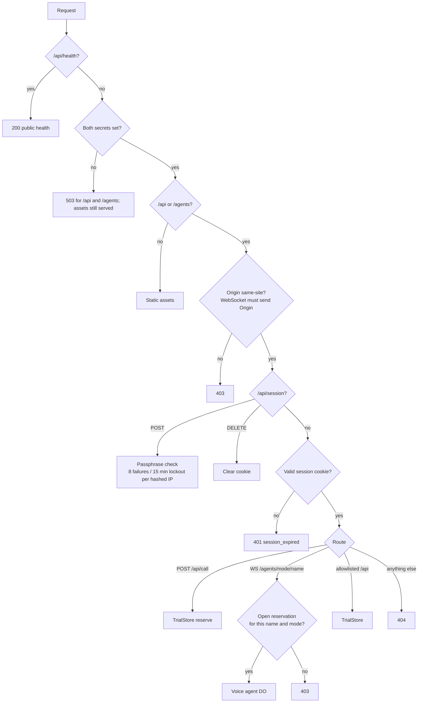
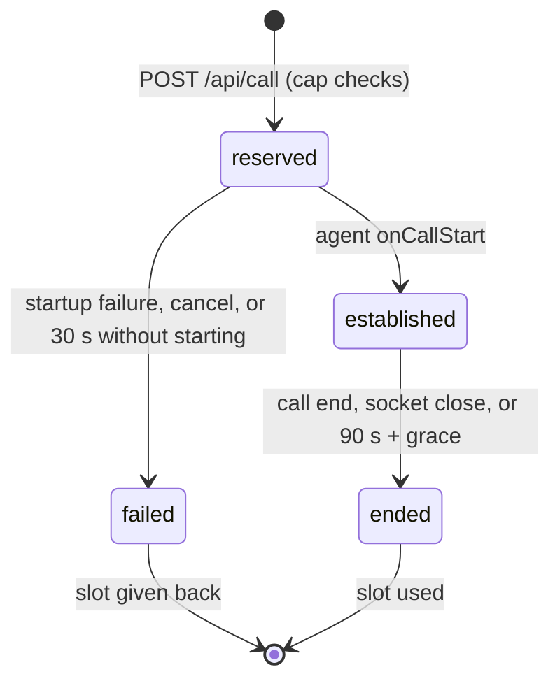
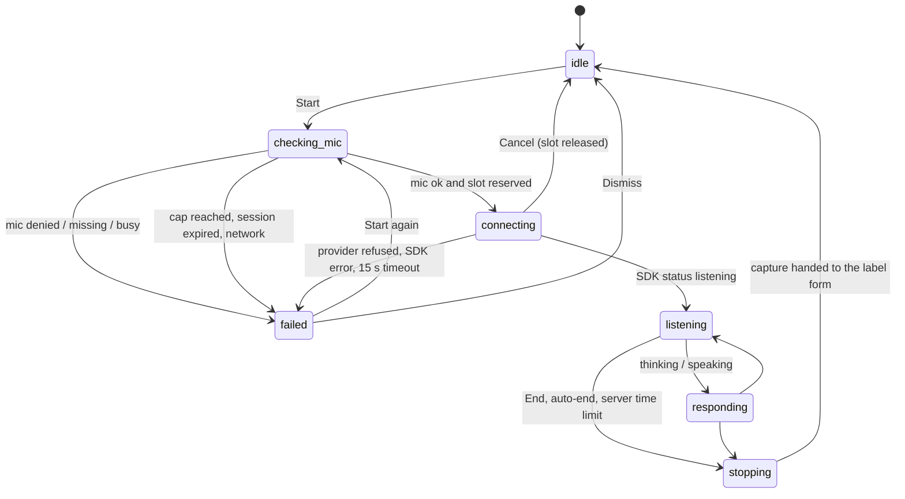

# Architecture

Verified against the code on the `build/v2` branch. File references are relative to the repository root.

## Components

| Component | Where | Responsibility |
|---|---|---|
| React app | `src/App.tsx`, `src/ui/*` | Sign-in, demo, guided workbench, labelling, report |
| Call hook | `src/ui/useCall.ts` | Microphone check, slot reservation, SDK connection, evidence capture |
| Call state machine | `src/lib/callMachine.ts` | Pure reducer for the call lifecycle |
| Worker | `src/server.ts` (default export) | Health, sign-in, origin checks, route allowlist, call reservation, WebSocket gating |
| `StandardVoiceAgent`, `PatientVoiceAgent` | `src/server.ts` | `withVoice(Agent)` subclasses that differ only in `eotThreshold` |
| `TrialStore` | `src/server.ts` | One Durable Object instance (`"pacelab"`) holding trials, calls, sign-in failures and the delete archive |
| Domain logic | `src/lib/*.ts` | Trial schema and validation, experiment plan, report, call accounting, failure classification |

## Request flow

Internal TrialStore routes (`call-reserve`, `call-check`, `call-event`, `auth-*`) are not in the public allowlist and return 404 from outside.

## Durable Object responsibilities

**Voice agents.** A fresh instance per call (`trial-<uuid>`), so no conversation history carries over. Each instance:
- builds a `WorkersAIFluxSTT` transcriber with its own `eotThreshold` and `eotTimeoutMs: 5000`;
- wraps the AI binding so that when Workers AI refuses a Flux session, the HTTP status and body are read, sanitized, logged and sent to the browser as `{ type: "pacelab_failure", code, detail }` (the SDK on its own reports only "Speech recognition failed to start");
- streams Gemma 4 with `reasoningEffort: null` (Gemma reasons silently for 5–21 s otherwise) and Aura-1 for speech;
- force-ends the call after 90 s;
- reports `established` on call start, `ended` or `failed` on call end or socket close, with the characters sent to TTS.

**TrialStore** (SQLite):

| Table | Holds |
|---|---|
| `trials` | One JSON trial per call id (schema 2) |
| `trials_archive` | Rows removed by delete-all, with a timestamp |
| `calls` | One row per reservation: state `reserved → established → ended`, or `reserved → failed` |
| `auth_failures` | Failed sign-ins per hashed client, pruned after 15 minutes |

## Call accounting

- The **daily cap (30)** counts reserved, established and ended calls. Failed starts give their slot back.
- The **attempt cap (90)** counts every reservation, so failed starts cannot be retried without limit.
- Only **one call** may be open at a time across both modes.
- A call name can be reserved once. Reconnecting the same open call reuses its slot; a finished call cannot be reopened.
- The **neuron estimate** sums Flux minutes (700 neurons/min) and Aura characters (about 1,364 neurons per 1,000) from the call rows. It is a floor, not a bill. Gemma is left out.

These rules are pure functions in `src/lib/quota.ts` and are unit-tested.

## Voice lifecycle in the browser

Ordering matters: the microphone is opened and released before anything is reserved, so a blocked microphone never costs a slot. The WebSocket opens only after the reservation succeeds. Each attempt carries a counter, so a slow step from an earlier attempt is ignored. `pagehide` ends the call so a closed tab releases the microphone and the server slot.

## Failure recovery

| Failure | Detected by | User sees | Slot |
|---|---|---|---|
| Microphone blocked or missing | `getUserMedia` before reserving | Failure card with browser-specific fix | not used |
| Daily or attempt cap | Reservation 429 | Failure card, reset time | not used |
| Workers AI allocation used up | Flux response read by the agent | "free daily allocation is used up", reset time banner | given back |
| Other Flux startup failure | SDK error plus provider detail | Cause and provider text | given back |
| No `listening` within 15 s | Browser timer | Startup timeout | given back after 30 s |
| Connection lost mid-call | SDK error | Label form preset to Excluded | used |
| Nothing recognized | No committed user turn | "Nothing was recognized" card | used |

## Authentication boundaries

- The passphrase is checked with a constant-time HMAC comparison. Session tokens are HMAC-signed with a separate secret and live in an `HttpOnly; Secure; SameSite=Strict` cookie, never in a URL.
- Sign-in failures are counted per HMAC of the client IP (the raw IP is not stored).
- Same-origin is enforced for every `/api` and `/agents` request that sends `Origin`, and WebSocket upgrades must send it.
- Static headers (`public/_headers`): `X-Frame-Options: DENY`, `nosniff`, `Referrer-Policy: same-origin`, and a `Permissions-Policy` that allows only this site's own microphone.
- Production does not forward SDK diagnostics to the browser.

## Measurement points

| Tag | Measure | Start | Stop | Clock |
|---|---|---|---|---|
| [SDK] | Speech start → final transcript | Flux speech start | Final transcript | Server |
| [SDK] | Final transcript → first audio | Final transcript | First TTS audio sent | Server |
| [SDK] | Model → first text | Model called | First text | Server |
| [SDK] | TTS → first audio | First TTS call | First audio | Server |
| [≈] | Perceived wait | Last mic level above 0.04 | Client status `speaking` | Browser |
| [≈] | Pauses held | Mic level drops for 0.7 s or more | Voice resumes | Browser |
